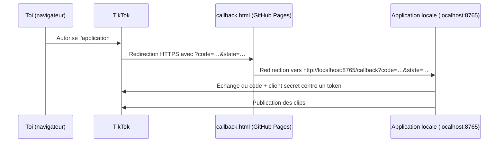

# Auto TikTok Clipper Upload

Outil local pour **préparer des clips vidéo et les publier automatiquement sur TikTok** via l'API officielle de TikTok.

Ce dépôt héberge la **page de redirection OAuth** (`callback.html`) utilisée pour connecter ton compte TikTok à l'application, qui, elle, tourne sur ton ordinateur.

<!-- À adapter : ajoute ici une phrase ou une capture d'écran/GIF de l'application en action -->

---

## Sommaire

- [Comment ça marche](#comment-ça-marche)
- [Contenu du dépôt](#contenu-du-dépôt)
- [Prérequis](#prérequis)
- [Installation](#installation)
- [Configuration de TikTok](#configuration-de-tiktok)
- [Utilisation](#utilisation)
- [Sécurité](#sécurité)
- [Dépannage](#dépannage)
- [Limites et avertissements](#limites-et-avertissements)
- [Licence](#licence)
- [Auteurs](#auteurs)

---

## Comment ça marche

TikTok impose une URL de redirection en HTTPS pour la connexion OAuth. L'application tournant en local (`http://localhost`), la page `callback.html` sert de **relais** : elle reçoit la réponse de TikTok et la transmet telle quelle à l'application sur ton ordinateur.



Le client secret n'est **jamais** envoyé à la page de redirection : il reste uniquement sur ton ordinateur.

---

## Contenu du dépôt

| Fichier | Rôle |
| --- | --- |
| `callback.html` | Page relais : récupère les paramètres renvoyés par TikTok (`code`, `state`…) et redirige vers `http://localhost:8765/callback`. |

<!-- À adapter : si tu ajoutes app.py, requirements.txt, etc. au dépôt, ajoute-les dans ce tableau -->

---

## Prérequis

- Python 3.9 ou plus récent
- Un compte TikTok
- Une application créée sur le [portail développeurs TikTok](https://developers.tiktok.com/) avec le produit **Login Kit** et l'API de publication de contenu (**Content Posting API**)
- Un compte GitHub (pour activer GitHub Pages et héberger `callback.html`)

---

## Installation

```bash
git clone https://github.com/PY95z/Auto-Tiktok-Clipper-Upload.git
cd Auto-Tiktok-Clipper-Upload

# Installe les dépendances
pip install -r requirements.txt
```

<!-- À adapter : vérifie que requirements.txt existe dans le dépôt, sinon liste les paquets à installer -->

---

## Configuration de TikTok

### 1. Activer GitHub Pages

Dans ton dépôt : **Settings → Pages**, puis choisis la branche `main` et le dossier `/ (root)`.

La page de redirection sera alors disponible à l'adresse :

```
https://py95z.github.io/Auto-Tiktok-Clipper-Upload/callback.html
```

### 2. Déclarer l'URL de redirection chez TikTok

Dans le portail développeurs TikTok, ajoute l'adresse ci-dessus dans les **Redirect URIs** de ton application.

### 3. Renseigner tes identifiants

Récupère ta **Client key** et ton **Client secret** sur le portail TikTok et renseigne-les dans la configuration de l'application locale.

<!-- À adapter : précise où (fichier .env, config.json, variables d'environnement…) et les noms exacts des variables -->

> ⚠️ Ne publie jamais ton client secret sur GitHub. Si tu utilises un fichier `.env`, ajoute-le à ton `.gitignore`.

---

## Utilisation

1. Lance l'application locale :

   ```bash
   python app.py
   ```

2. Clique sur le bouton de connexion TikTok et autorise l'application.
3. TikTok te redirige vers `callback.html`, qui te renvoie automatiquement vers l'application (`localhost:8765`).
4. Une fois connecté, l'application peut préparer et publier tes clips.

<!-- À adapter : décris les vraies étapes (dossier des vidéos, durée des clips, légendes, hashtags, planification…) -->

---

## Sécurité

- Le **code d'autorisation** transmis par `callback.html` est à usage unique et **inutilisable sans ton client secret**, qui reste sur ta machine.
- `callback.html` n'enregistre ni ne stocke aucune donnée : elle redirige simplement vers `localhost`.
- Ne partage jamais ton client secret ni tes tokens d'accès.

---

## Dépannage

**La connexion ne se termine pas toute seule**
L'application locale n'est probablement pas lancée. Lance `python app.py`, puis colle l'adresse de la page de redirection dans l'application (option « La connexion ne se termine pas toute seule ? »).

**Le navigateur n'arrive pas à ouvrir `localhost:8765`**
Vérifie que l'application tourne et qu'aucun autre programme n'utilise déjà le port 8765.

**Changer de port**
Le port est défini à deux endroits qui doivent rester identiques :
- `PORT` dans `app.py`
- `var PORT` dans `callback.html`

**Erreur `redirect_uri` côté TikTok**
L'URL enregistrée sur le portail TikTok doit correspondre exactement à celle de ta page GitHub Pages (majuscules, `/` final, etc.).

---

## Limites et avertissements

- Tant que ton application n'a pas été auditée par TikTok, les publications via l'API peuvent être limitées (par exemple en visibilité privée). Consulte la documentation officielle de la Content Posting API.
- Respecte les [conditions d'utilisation de TikTok](https://www.tiktok.com/legal/page/global/terms-of-service/fr) et les droits d'auteur des vidéos que tu découpes et publies.
- Ce projet n'est ni affilié ni approuvé par TikTok.

---

## Licence

<!-- À adapter : choisis une licence (ex. MIT) et ajoute un fichier LICENSE -->
Ce projet est distribué sous licence MIT. Voir le fichier `LICENSE`.

## Auteurs
Amine O
Wissam O
